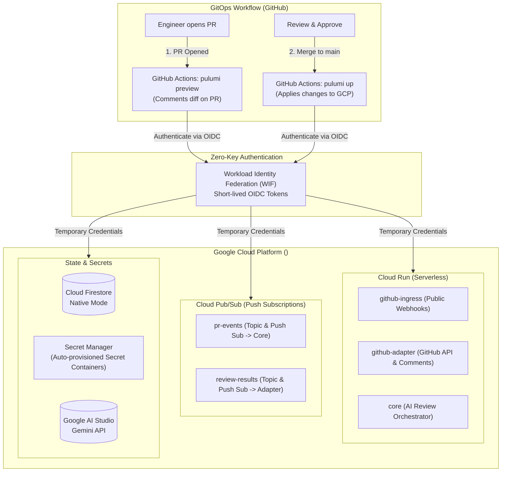

# Code Review Agent - GitOps Cloud Infrastructure 🏗️

This repository is a **pure GitOps infrastructure repository** managing the Google Cloud Platform (GCP) resources for the multi-agent [Code Review Agent](https://github.com/usermeme/code-review-agent) using **Pulumi (TypeScript)** and **pnpm**.

---

## 🏛️ Architecture & GitOps Flow

This repository manages cloud infrastructure strictly through **Infrastructure as Code (IaC)**. No manual bash scripts or imperative local commands are needed.



---

## 🔒 Modern GitOps Principles Applied

1. **No Static Keys**: Zero `.json` service account keys. Authentication uses **Google Cloud Workload Identity Federation (WIF)** via cryptographic OIDC tokens minted per workflow run.
2. **Declarative Everything**: All Cloud Run services, Pub/Sub topics/subscriptions, Firestore databases, and IAM bindings are declared in Pulumi.
3. **The "Empty Secret" Pattern**:
   - When you need a new secret, declare it in Pulumi.
   - When your PR merges to `main`, Pulumi creates the secret container in **Google Secret Manager** (with a safe placeholder version).
   - Anyone with GCP access can then populate the sensitive value directly in Secret Manager or via GitHub Secrets.
4. **Clean Separation of Concerns**:
   - **Application Repo**: Compiles code and publishes container images.
   - **This Infra Repo**: Defines cloud topology, routing, security policies, and consumes image tags.

---

## 🚀 Step-by-Step Setup Guide

### Step 1: One-Time Bootstrap (Workload Identity Federation)

Run the one-time helper script to configure Workload Identity Federation in your GCP project. This allows GitHub Actions to talk to GCP without static keys:

```bash
export GCP_PROJECT_ID="your-gcp-project-id"
export GITHUB_REPO="usermeme/code-review-agent-infra-example"
pnpm run setup:wif
```

The script will output two values:

- `GCP_WORKLOAD_IDENTITY_PROVIDER` (e.g., `projects/123456/locations/global/workloadIdentityPools/github-actions-pool/providers/github-provider`)
- `GCP_SERVICE_ACCOUNT` (e.g., `sa-pulumi-deployer@your-gcp-project-id.iam.gserviceaccount.com`)

---

### Step 2: Configure GitHub Repository

Go to your repository settings: **Settings** → **Secrets and variables** → **Actions**:

#### 1. Repository Variables (Non-sensitive)

Click **Variables** tab → **New repository variable**:

- `GCP_WORKLOAD_IDENTITY_PROVIDER`: _(From Step 1 output)_
- `GCP_SERVICE_ACCOUNT`: _(From Step 1 output)_
- `GCP_PROJECT_ID`: `your-gcp-project-id`

_(All other settings like project, region, image registry, and model are declared in `Pulumi.prod.yaml`)_

#### 2. Repository Secrets (Sensitive)

🎉 **NONE NEEDED! (Zero Secrets)**

- Pulumi state is saved in your own private Google Cloud Storage bucket (`gs://<your-gcp-project-id>-pulumi-state`). You do **not** need to register at app.pulumi.com or create a `PULUMI_ACCESS_TOKEN`.
- All runtime secrets live directly in **Google Cloud Secret Manager**:
  - `code-review-github-token` (`GITHUB_TOKEN`): GitHub Personal Access Token.
  - `code-review-github-webhook-secret` (`GITHUB_WEBHOOK_SECRET`): GitHub Webhook HMAC secret.
  - `code-review-gemini-api-key` (`GEMINI_API_KEY`): Google AI Studio API key.

> [!TIP]
> **100% Secretless GitHub CI/CD**: Your GitHub Repository Secrets tab can remain completely empty! GitHub Actions authenticates keylessly via Workload Identity Federation (WIF).

---

### Step 3: Trigger Deployment via Git

You are done! All future infrastructure changes happen strictly via Git:

```bash
git add .
git commit -m "feat: setup pure GitOps with Workload Identity Federation"
git push origin main
```

1. Merging to `main` triggers `.github/workflows/pulumi.yml`.
2. Pulumi provisions:
   - Required GCP APIs
   - Cloud Firestore Database
   - Cloud Pub/Sub topics & push subscriptions (`pr-events`, `review-results`)
   - Secret Manager secrets
   - 3 Cloud Run microservices (`code-review-github-ingress`, `code-review-github-adapter`, `code-review-core`)
3. Pulumi outputs your **`githubWebhookUrl`**.

---

### Step 4: Configure GitHub Organization Webhook

Once deployed, set up the webhook in your GitHub Organization:

1. Go to **Organization Settings** → **Webhooks** → **Add webhook**.
2. **Payload URL**: `https://<YOUR_INGRESS_URL>/api/v1/webhooks` (from Pulumi output `githubWebhookUrl`).
3. **Content type**: `application/json`.
4. **Secret**: Value of `GITHUB_WEBHOOK_SECRET` (configured in Secret Manager `code-review-github-webhook-secret`).
5. **Events**: Select **Pull requests** and **Issue comments**.

---

## 🔍 Testing & Verification

Verify webhook health and HMAC signature verification:

```bash
./scripts/test-webhook.sh https://<GATEWAY_URL> "your-webhook-secret"
```

---

## 💻 Local Development (Optional)

If you wish to test Pulumi locally on your machine:

```bash
# Build TypeScript
pnpm run build

# Preview changes locally
pnpm run pulumi:preview

# Deploy from local machine
pnpm run pulumi:up
```
